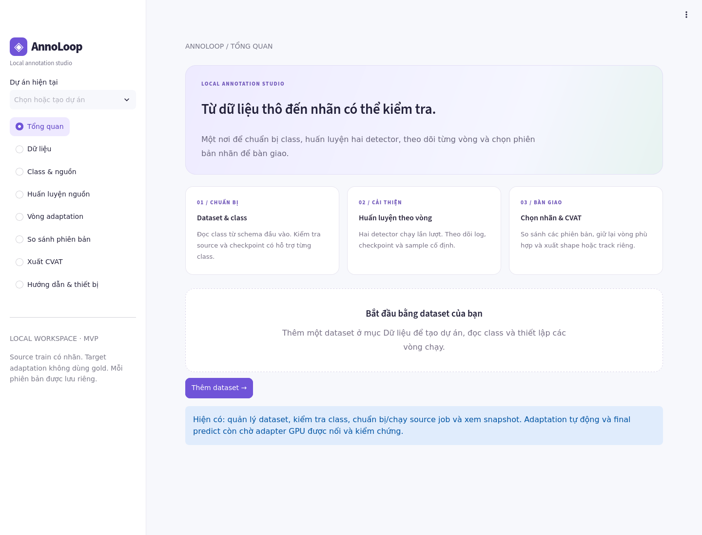

# AnnoLoop MVP

Ứng dụng Streamlit chạy local để thích nghi **SECOND-IoU + PV-RCNN** với point cloud chưa có nhãn. Người dùng chọn folder, chọn class, theo dõi từng vòng và giữ phiên bản nhãn phù hợp.



## Clone và chạy

Repo private: tài khoản GitHub của người clone cần được cấp quyền truy cập.

```bash
git clone https://github.com/Hvaa1/annoloop-mvp.git
cd annoloop-mvp
bash scripts/setup.sh --gpu
bash scripts/start_ui.sh
```

Mở **http://localhost:8502**. Lần cài đầu tải dependency và biên dịch CUDA nên cần Internet và có thể mất nhiều phút. Các lần mở sau chỉ chạy `bash scripts/start_ui.sh`.

**Máy hỗ trợ:** Linux x86_64, Python 3.10, NVIDIA driver hoạt động (`nvidia-smi`), GCC/G++ 6–11 và Python development headers. Profile model cố định Torch 2.0.0 + CUDA 11.8, spconv 2.3.6; GPU cần tương thích profile này và đủ VRAM cho dataset/model. Chưa bảo đảm mọi NVIDIA GPU chạy được. [Cài đặt và xử lý lỗi](docs/INSTALL.md).

Muốn mở UI trước khi cài môi trường model:

```bash
bash scripts/setup.sh --ui
bash scripts/start_ui.sh
```

Chế độ này chỉ mở giao diện; predict/train vẫn cần GPU profile. Không có detector CPU.

## Đưa dữ liệu của bạn vào

1. **Source có nhãn:** hiện hỗ trợ nuScenes mini/trainval có infos 1-sweep train/validation. Nếu mới tải nuScenes raw, chuẩn bị bằng:

   ```bash
   bash scripts/prepare_source.sh --input /path/to/nuscenes-raw --output /path/to/nuscenes-prepared --version v1.0-mini
   ```

   Input là nuScenes raw đã giải nén đầy đủ, gồm `samples/`, `maps/` và bảng metadata `v1.0-mini/` (`sample.json` cùng các bảng khác). Output là folder riêng; tool giữ nguyên source raw, tạo liên kết media và infos theo scene split chính thức. Chọn output trong UI. Dùng `--version v1.0-trainval` với bản trainval.

2. **Target chưa có nhãn:** folder PCD/NPY/BIN. Trong **Dữ liệu**, chọn source, target và class cần có. Schema, inventory và YAML được tạo tự động ở storage dự án; bạn không phải viết chúng.
3. **Checkpoint:** repo không chứa weights. Chọn checkpoint đã xác minh có metadata/config tương ứng, hoặc chọn **Không có checkpoint · học mới** để train trên source. Tool bỏ source pretrain nếu checkpoint hỗ trợ đủ class; chỉ học nguồn cho detector còn thiếu class.
4. **Adaptation:** xác nhận XYZ theo mét và hệ LiDAR X trước/Y trái/Z lên, kiểm tra adapter GPU A → B rồi chạy. Chọn số vòng, epoch và chế độ thủ công/tự động.
5. **Theo dõi:** xem log/loss/PID/checkpoint trong app; sau mỗi vòng xem cùng frame sample A/B trước/sau, chọn nhãn hoặc rollback.

[Hướng dẫn từng màn hình](docs/USER_GUIDE.md) · [Bộ nhớ pseudo-label](docs/PSEUDO_LABEL_MEMORY.md).

## Những gì đã có

- Hai detector chạy **lần lượt**, calibration confidence/quality bằng source validation.
- Hợp nhất dự đoán A/B và lịch sử qua các vòng; train hai detector trên cùng pseudo-label với source loss.
- Bộ nhớ pseudo-label: giữ nhãn có bằng chứng ổn định, đưa mâu thuẫn vào ignore, giới hạn số vòng giữ nhãn.
- Số vòng tùy chọn, chạy thủ công/tự động, chọn nhãn bằng tay/theo ngưỡng, dừng sớm và rollback.
- Checkpoint mỗi **10 epoch + epoch cuối thành công**; giữ log/checkpoint khi ngắt và tiếp tục từ artifacts hợp lệ.
- Sample point cloud/box trước và sau từng M; xem kết quả đã lưu không chạy lại model.
- Kho model, kiểm tra class/adapter và nhánh ghép checkpoint local inference tuần tự.
- Final inference theo phiên bản đã chọn, viewer accepted/ignore và tạo task shape trên CVAT bằng thao tác rõ ràng.
- Sáu bước điều hướng, giữ so sánh phiên bản/rollback và cache đường đọc dữ liệu. Xem [tối ưu UI/backend](docs/UI_PERFORMANCE.md).

**Giới hạn hiện tại:** Final delivery UI hỗ trợ shape; xem [hướng dẫn bàn giao](docs/FINAL_DELIVERY.md). Adaptation UI hiện dùng nhãn không tracking; tracking cần thêm sequence/timestamp/ego pose và nối đầy đủ. Nhánh ghép nhiều checkpoint chỉ inference, chưa train N model. Model tải được chưa có nghĩa adapter đủ train/calibration; các cổng kiểm tra tương thích vẫn áp dụng. 2D có schema/export contract nhưng chưa có detector/trainer. Đây là co-training có source loss và bộ nhớ nhãn, chưa phải bản tái hiện đầy đủ ST3D++ (DSNorm/EMA/curriculum còn thiếu). Các proxy agreement/confidence không thay thế đánh giá accuracy/recall.

Gold target chỉ dùng đánh giá cuối, không dùng để chọn pseudo-label hoặc train target.

## Cấu trúc

```text
src/annoloop/             backend, adapter, vòng chạy, version và memory
ui/                      Streamlit, biểu đồ, CSS
configs/source_templates/ profile detector; app tự tạo YAML dự án
scripts/                 cài đặt, mở app, chuẩn bị source, theo dõi train
tests/                   kiểm tra backend/UI; tạo fixtures trong folder tạm
docs/                    hướng dẫn, validation và tài liệu thiết kế
vendor/ST3D/             mã runtime/CUDA đã chỉnh cho adapter; license kèm theo
requirements-*.txt       dependency trực tiếp theo môi trường UI/GPU
constraints-*.txt        phiên bản đã kiểm chứng, gồm dependency gián tiếp
```

Khi chạy sẽ tạo `.venv/`, `.venv-gpu/`, `runtime/` và `data/`. **Toàn bộ database, dataset, nhãn, checkpoint, log, credential và project đang có trên máy gốc không được đưa vào repo.** Máy clone bắt đầu với storage rỗng; dữ liệu mới cũng được `.gitignore` loại khỏi commit.

## Lệnh hữu ích

```bash
bash scripts/annoloop.sh doctor
bash scripts/watch_train.sh
# Tuỳ chọn: cài thêm dependency cho test khôi phục Adam, rồi chạy suite.
bash scripts/setup.sh --ui --test
bash scripts/check.sh
```

Đổi cổng: `ANNOLOOP_PORT=8503 bash scripts/start_ui.sh`. Mặc định app bind localhost. Cấu hình đường dẫn qua `.env.example`; chưa có Docker nhưng backend/storage/worker đều hỗ trợ biến môi trường.

Mã runtime bên thứ ba và ghi nhận thay đổi: [THIRD_PARTY_NOTICES.md](THIRD_PARTY_NOTICES.md).
