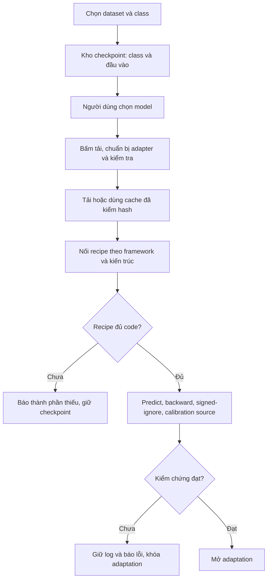

# Chọn checkpoint và kiểm chứng adapter

Luồng sử dụng:

## Thao tác trên app

1. **Dữ liệu:** chọn folder source, target và class cần làm.
2. **Class & model:** chọn A/B một lần. Bộ lọc dùng class và feature đầu vào,
   không loại checkpoint chỉ vì thiếu code adaptation. Đầu vào chưa có bằng
   chứng được ghi **chờ xác minh**; thiếu feature đã biết hoặc thiếu class vẫn
   bị chặn ở chế độ mặc định. Không đọc target gold để quyết định class/model.
3. **Chuẩn bị model:** xác nhận mét/trục LiDAR và số cột BIN, rồi bấm
   **Tải, chuẩn bị adapter & kiểm tra model**. Một tác vụ nền tải các model
   đã chọn, dùng lại cache hợp lệ, nối recipe và gửi kiểm chứng nếu đủ code.
   Cùng một model ở cả A/B chỉ cần tải một lần. Theo dõi bảng trạng thái và
   log ngay trên trang; có nút dừng, file đã có và log được giữ lại.
4. Chỉ khi các bước đạt mới bấm **Mở vòng adaptation →**. Nút này không train;
   cấu hình và chạy vòng ở trang adaptation như trước.

Checkpoint native thiếu class vẫn đi qua bước học source có nhãn hiện có;
thiếu code adapter không phải lý do để train thêm. Model đã đủ class không bị
ép pretrain. Nhánh ghép nhiều checkpoint local vẫn là inference riêng, chưa
phải huấn luyện adaptation nhiều kiến trúc.

## Kiểm chứng thực sự làm gì?

Với hai recipe native đang được duy trì (SECOND-IoU và PV-RCNN):

| Bước | Điều kiện đạt |
|---|---|
| File và dữ liệu | Hash checkpoint/config/source không đổi; hợp đồng feature và xác nhận trục/đơn vị khớp |
| Predict | Chạy inference source và target mẫu bằng worker model; kiểm tra điểm confidence và IoU riêng |
| Backward | Loss hữu hạn và gradient hữu hạn, khác 0 trên tham số cần học ở source và target |
| Signed-ignore | Thêm box ignore chẩn đoán từ source và xác nhận thực sự có anchor nền chuyển sang ignore |
| Calibration | Predict **toàn bộ source validation**; fit confidence/quality theo class, tối thiểu 10 dự đoán/class |

Kiểm tra này dùng **0 optimizer step**, không ghi đè weights, không tạo nhãn
train từ batch chẩn đoán, không dùng target gold. Calibration có thể lâu vì
không chỉ chạy một frame. Ngưỡng 10 dự đoán là điều kiện đủ mẫu để fit, không
phải chứng minh model có accuracy tốt. Mất object hoặc dự đoán sai vẫn cần
được đánh giá chất lượng riêng.

Chứng nhận gắn với hash artifact kiểm tra/calibration, checkpoint, config,
source, dataset, class và hợp đồng point cloud. Thay dữ liệu/class/model sẽ
không được dùng lại chứng nhận không khớp. Dự án đã có lịch sử không bị tự sửa
snapshot; các lựa chọn model mới bật giao thức kiểm chứng đầy đủ. Bấm kiểm
chứng lại trên dự án cũ cũng bật giao thức này.

## Giới hạn hiện tại

Cập nhật: đã viết [recipe MMDetection3D](MMDET3D_ADAPTER.md) cho hai head
`CenterHead`/`Anchor3DHead` trên một số model một tầng. Code nối predict/train/
ignore/calibration; chỉ mở quyền chạy sau chứng nhận GPU thực tế. Input cần
sweep/time bị chặn trong chế độ strict; người dùng có thể xác nhận current-scan
mode để dùng Δt=0, không có lịch sử. Mô tả generic chưa nối bên dưới áp dụng
ngoài phạm vi này.

Script nối **recipe đã được viết**, không tự sinh thuật toán train mới từ tên
model. Các gói OpenPCDet/MMDetection3D generic hiện có binding/raw predict;
train target, signed-ignore và calibration chưa được nối đầy đủ vào vòng.
App cho chọn/tải, nhưng báo thiếu code và giữ adaptation bị khóa. Không lấy
confidence thay cho chất lượng IoU và không gửi model generic vào native trainer.

Đợt triển khai này chỉ kiểm thử bằng fixture và worker giả lập; chưa tải model,
chưa chạy kiểm chứng GPU thật, chưa train và chưa gọi CVAT. Bằng chứng chạy
thật chỉ được tạo sau khi người dùng bấm nút kiểm chứng với dữ liệu của mình.

Backend: `preparation.py`, `preparation_jobs.py`, `adaptation_worker.py`.
Giao diện: `ui/preparation_page.py`, `ui/project_models.py`.
