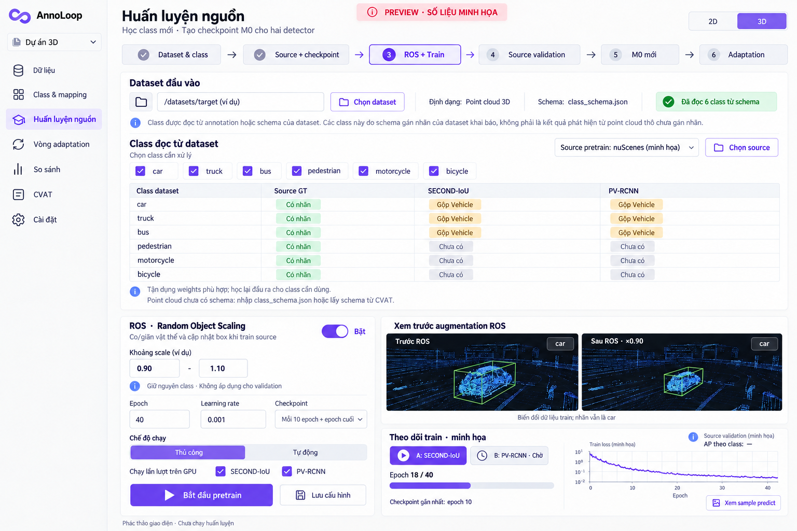

# Bàn giao UI cho Astra

Cập nhật 13/10/2026: người dùng đã yêu cầu dựng UI. Giao diện hiện có tại `ui/app.py`;
xem `USER_GUIDE.md`. Nội dung bên dưới giữ làm định hướng; chưa tạo Docker.
Làm UI Streamlit trong `ui/` riêng; `.venv` được tạo bằng scripts/setup.sh.
Không thay backend bằng code UI hoặc dữ liệu mẫu giả. NativeDetectorAdapter
đã nối trong adaptation.py/adaptation_worker.py; nút chạy dựa trên readiness
của dự án (checkpoint, coordinates và verification), không mở vô điều kiện.

## Phong cách đã chọn

Tên AnnoLoop. Nền trắng/ngà, tím làm màu hành động chính, chữ rõ, spacing thoáng.
Sidebar: Dữ liệu → Class & mapping → Huấn luyện nguồn → Vòng adaptation →
So sánh → CVAT → Cài đặt. Shell có switch 2D/3D; 2D hiện chỉ có schema/export
contract, chưa có detector. Không cho bật ROS 3D trên 2D.

Ảnh chỉ là reference thiết kế. Các class, đường dẫn và thống kê trong ảnh là ví dụ.

## Các màn hình và backend

| Màn hình | API/backend | Hành vi |
|---|---|---|
| Dataset | `inspect_dataset`, `discover`, `ProjectStore.create` | Folder trước, đọc schema sau; class hiển thị từ dataset; không hardcode 6 class |
| Class | `compatibility.matrix`, `source_counts`, `checkpoint_metadata` | Tách source train/val counts với checkpoint đã học; mapping rộng/hẹp hiện amber; không tự chấp nhận |
| Source pretrain | `source_config`, `jobs.start_pretrain/start_source_pair` | ROS preview, epoch/LR từ profile, 2 model lần lượt; thiếu class/anchor/source thì chặn |
| Theo dõi | `jobs.status`, `read_log`, `device.probe` | PID thật, log/epoch, checkpoints; không suy live từ log cũ; không restart khi rerun UI |
| Adaptation | `RoundController`, `ProjectStore.next_round/request_finish` | Số vòng tùy chọn; manual từng vòng hoặc automatic; dừng sau vòng đang chạy |
| Review vòng | `ProjectStore.get/select`, `SelectionPolicy` | Fixed sample A/B + consensus, trước/sau; chọn mới hoặc quay lại vòng cũ; thresholds có thể cấu hình |
| CVAT | `cvat.package/export_media/upload` | Shape/track task riêng; upload explicit; credential chỉ trong memory; không overwrite review |

`RoundController` dùng NativeDetectorAdapter qua subprocess model venv. Source/
target predict và target trainer source-assisted đã có; kiểm tra GPU A → B có
0 optimizer step. Mỗi dự án mới cần kiểm tra GPU trên dữ liệu/checkpoint của chính nó.
Không mang chứng nhận từ máy hoặc dự án khác sang. Final delivery/CVAT chưa enable.
Streamlit gọi worker/background service, không gọi vòng train trực tiếp trong
script page. State bền ở backend, `session_state` chỉ lưu selection/view.
Không giữ thread executor làm nguồn duy nhất xác định run đang sống.

## UX cần giữ

1. Chọn dataset, đọc class, rồi mới kiểm tra checkpoint/source. Nếu target là
   point cloud không nhãn: nhập class schema hoặc lấy schema CVAT. Không chạy
   detector để khẳng định class nào hiện diện trước bước này.
2. Hai điều khiển khác nhau: **cách chạy train** và **cách chọn phiên bản nhãn**.
   Automatic train vẫn có thể dừng chờ manual review.
3. So sánh trên cùng frame mỗi vòng. Hiện class, confidence đã calibration,
   quality, point support, origin, track, policy positive/ignore/review.
   Viewer mới đọc raw prediction A/B trước/sau train, score gốc và point cloud
   BEV. Cập nhật mỗi 5 giây, không dispatch GPU. Xem được cả lượt bị ngắt;
   frame chưa có không hiển thị thành zero detections. Chỉ snapshot nhãn chung
   đã hoàn tất mới được chọn làm phiên bản. Ưu tiên lượt có predict sau train.
4. Source validation AP/precision/recall phải hiện đúng domain; proxy target
   không gắn nhãn accuracy. Thiếu metric thì hiện chưa có, không sinh số giả.
5. Phân biệt **vòng vừa train** và **vòng nhãn đang chọn**. Rollback giữ toàn bộ
   snapshot; không delete vòng mới. Giữ checkpoint 10 epoch và cuối.
6. Nếu ngắt job: giữ log và checkpoint. Cho chọn lượt hợp lệ rồi **Tiếp tục vòng
   M…** sau khi worker cũ thoát: giữ model đã hoàn tất, dùng cache predict đúng
   hash, khôi phục model/Adam tại checkpoint epoch. Nếu chưa có checkpoint target
   thì train lại riêng model còn dở; không hứa khôi phục iteration chưa lưu/RNG.
   Resume theo execution/selection mode: tự động tiếp tục nếu nhãn được chọn,
   manual selection chờ duyệt, manual execution dừng sau một vòng. Vòng đầu
   bị automatic selection từ chối thì dừng vì chưa có nhãn để train tiếp.
   Hiện lý do cùng proxy/ngưỡng ở Vòng adaptation và So sánh phiên bản; phân biệt
   manual override với automatic accept. **Chạy lại vòng M…** là thao tác
   riêng bắt đầu toàn bộ vòng trong lượt mới. Không dispatch khi refresh.
   Monitor refresh toàn app khi
   job nền kết thúc để cập nhật readiness và mở lại các nút.
   Nếu cờ kết thúc đang bật, hiện **Cho phép chạy tiếp**; chỉ bỏ cờ sau thao tác
   người dùng và khi không còn worker, không tự dispatch.
   Class adaptation có thể là subset của schema/checkpoint trước vòng đầu.
   Calibration và nhãn dương chỉ dùng subset; dự đoán ngoài subset giữ làm
   ignore, source loss vẫn theo config gốc. Không đổi head hay ID class.
   Pseudo-label memory mặc định bật cho controller mới, riêng với tracking.
   UI có số lần xác nhận và cửa sổ giữ khi bỏ sót. So sánh phiên bản đọc memory
   snapshot có hash và hiển thị lịch sử mỗi box theo frame; không dispatch GPU.
   Nhãn giữ theo lịch sử không tăng agreement. Vòng bị từ chối được ghi vào lịch
   sử nhưng không tự đổi nhãn train. Xem PSEUDO_LABEL_MEMORY.md.
7. Màn CVAT chỉ export dataset bàn giao đã có final predictions từ version
   được chọn. Hiện rõ số frame xuất; không gán holdout vào pseudo-label train.
8. Device: NVIDIA GPU, một worker; `.venv` VIN_Ai mặc định. Thiếu CUDA/runtime
   thì hiện preflight blocker. Không có fallback CPU detector.

## Chuyển Docker sau này

UI/backend/worker tách module. Dữ liệu và runtime đặt ngoài code bằng env/mount.
Không thêm Compose/Dockerfile trong phase này. Giữ API service ổn định để có thể
thay storage/queue và chạy worker thành container riêng sau này.
